# wsi-invest-ai

Assistente pessoal de investimentos com **agente de IA**: organiza carteira, compara renda fixa, acompanha macro (Selic, IPCA, CDI), projeta patrimônio, emite alertas e explica decisões — **sem executar ordens**.

> **Aviso:** ferramenta educacional e analítica. Não é recomendação de investimento, não substitui contador/consultor e não executa operações.

## Funcionalidades

### Plataforma

- **Multi-tenant** com papéis (`OWNER/ADMIN/MEMBER/VIEWER`) e isolamento testado.
- **Empresas (PJ):** crie e vincule empresas à mesma conta; gerencie PF e PJ trocando de workspace (cada um com carteira e extratos próprios).
- **Auth:** e-mail/senha (Argon2), Google OAuth, JWT + refresh rotativo, **2FA (TOTP)**, troca e reset de senha.
- **Admin** (`ADMIN_EMAILS`): visão geral, usuários e uso de IA.
- **Hardening:** Helmet, rate limit global e no login/registro, CORS configurável, chaves criptografadas.

### Investimentos

- **Carteira:** ativos, contas, transações, posições, alocação e resumo.
- **Renda fixa:** simulação e comparação CDB/LCI/LCA/Tesouro com IR/isenção.
- **Macro:** Selic, IPCA e CDI via BCB (cache).
- **Cotações:** B3 (brapi) e cripto (CoinGecko), atualização manual e agendada.
- **Câmbio e ouro:** USD/BRL, EUR/BRL, GBP/BRL (AwesomeAPI) e ouro (gold-api) com conversão para BRL.
- **Análise:** runway, projeção de patrimônio e rebalanceamento.
- **Tracking de ações:** gráfico único (preço, MM20/MM50, suportes/resistências), RSI, volatilidade, resumo com perspectiva e ganho/risco.
- **Vidente de dicas:** análise geral — varre o universo, identifica o padrão atual de cada papel e ranqueia pelo histórico desse padrão (acerto e retorno em 10/20 pregões), com comparação entre padrões.
- **Aprendizado:** registra os sinais que o app gera, mede o acerto depois de ~14 dias e calibra o score pelas regras que mais acertam.
- **Descobertas:** varre um universo curado (B3, EUA e cripto), pontua técnica + ganho/risco + histórico do padrão e mantém a watchlist (cron semanal + manual).
- **Alertas** de alocação e macro.
- **Extratos bancários:** importação de **OFX/CSV/PDF** (upload ou colar) com categorização automática, entradas, saídas, saldo, resumo por categoria e **conciliação com a carteira**.
- **Importação CSV** e **relatórios CSV/PDF**.

### Agente de IA

- **Multi-provedor** (OpenCode padrão, OpenAI, OpenRouter, Groq, DeepSeek, Mistral, Together, Gemini, LM Studio, Ollama).
- **Tools determinísticas** (carteira, macro, renda fixa, notas, memória, análise) com **citação de fonte e data**.
- **Streaming (SSE)** token a token, com fallback.
- **Perfis de agente** (geral, renda fixa, planejador, macro, cripto) — cada um com prompt e ferramentas próprios.
- **Memória do agente** (`remember`/`search_memory`) e **notas** (`search_documents`).
- **Insights periódicos**: dicas geradas por IA a partir de **notícias (RSS)** + **indicadores (Selic/IPCA/CDI)** + **carteira**, com painel dedicado, **filtro por categoria**, **badge de não lidos** e **digest por e-mail**.
- **Radar de oportunidades**: analisa narrativas (IA, cripto, metaverso, NFTs, chips, energia…) com **atenção, hype risk, estágio do ciclo, riscos, sinais de confirmação/invalidação e regras de saída** — sem recomendar compra/venda.
- **Radar contrário**: varre o universo + carteira atrás do que **caiu e dá sinal de virada** (RSI em sobrevenda, suporte próximo, ganho/risco e repique), com nota de reversão.
- **Ciclo do halving (BTC/ETH)**: dias até o próximo halving (estimado), fase do ciclo e referência histórica dos ciclos anteriores (dias do halving ao topo, drawdown seguinte).
- **Oportunidades de negócio**: usa seu perfil (skills, experiência, formação) para gerar caminhos de negócio com **fit, primeiros passos e validação barata**.
- **Chat global**: widget flutuante em qualquer tela (com atalho para a tela cheia), markdown, parar e raciocínio visível; o agente consulta a leitura técnica de qualquer ticker e **cadastra papéis na watchlist de Descobertas**.
- **Prompts versionados** com avaliação automática (conjunto dourado) e ativação com rollback — o chat usa a versão ativa.
- **Auto-ajuste de prompt (autonomia L5)**: ciclos diários que redigem candidato corrigindo falhas medidas, avaliam e promovem só com margem sobre o baseline; o resultado fica no feed de Insights.
- **Swarm**: segunda-feira roda o ciclo para **todos os perfis em paralelo** (cada agente cuidando do próprio prompt), com relatório único.
- **Análise de imagens no chat**: anexo/paste de imagem; modelo com visão nativa enxerga direto, sem visão usa duas etapas (`AI_VISION_MODEL`) ou OCR local (tesseract) — degrada com elegância.
- **Assistente financeiro**: página **Finanças** cadastra caixa pessoal e da empresa (saldo, reserva, receitas/despesas). O contexto de caixa entra no system prompt de TODA conversa e a ferramenta `get_cash_position` dá detalhes — dicas de aporte passam a respeitar o que existe de caixa (nunca acima do disponível, reserva antes de risco, capital de giro da empresa preservado).
- **Ferramentas de análise combinada no chat**: `compare_assets` (X ou Y, mesma régua), `correlation` (diversificação real), `portfolio_backtest` ("e se eu tivesse investido X%…"), e escritura financeira pelo chat (`add_finance_entry`, `update_cash`).
- **Simulações de prompt por classe**: backtest (`/prompts/sim/*`) mede qual instrução prevê melhor a direção futura por classe de ativo (banco, commodity, tech…) e a vencedora entra no chat automaticamente.
- **Módulo de ensino**: 12 aulas para aprender a investir — trilha geral (gráficos, suporte/resistência, tendência e médias, RSI, ganho/risco, ciclos e diversificação) + **trilha de cripto** (101, custódia e seed phrase, segurança e golpes, tributação no Brasil, ciclo do halving, altcoins e stablecoins), com **exemplos ao vivo** e **exercícios corrigidos na hora**; progresso salvo por usuário.
- **Notificações de oportunidades quentes**: sino no app com badge + painel e **notificações do navegador** quando surgir veredito `Oportunidade` ou `Reversão forte` (cron diário de varredura, dedupe por dia).
- **Paper trading (L2)**: propostas com justificativa executadas em carteira simulada, comparadas com CDI; sem dinheiro real.
- Quota mensal, histórico de conversas, passos visíveis e auditoria.

## Stack

- **Back:** NestJS 11 · Prisma 6 · SQLite · Swagger.
- **Front:** Angular 20 · PrimeNG 20 (Aura) · ECharts (ngx-echarts) · primeicons.
- **IA:** OpenAI SDK (adaptador compatible), SSE.
- **Infra:** local-first, sem Docker (SQLite em arquivo).

## Início rápido

```bash
cd wsi-invest-ai
./scripts/up.sh        # sobe API (3000) e front (4200) — SQLite, sem Docker
```

Ou manualmente:

```bash
cd back && cp .env.example .env   # edite segredos e OPENCODE_API_KEY
cd back && npm install && npx prisma db push && npm run seed && npm run build
cd back && nohup node dist/main > /tmp/wsi-api.log 2>&1 &
cd ../front && npm install && npm start -- --host 0.0.0.0
```

**Usuários de demonstração (via `npm run seed`):**

| E-mail | Senha | Perfil |
|---|---|---|
| `admin@wsi.local` | `admin123` | admin (acesso a `/admin`) |
| `demo@wsi.local` | `demo123` | carteira de exemplo (ações, FIIs, ETF, cripto e renda fixa) |

- **Web:** http://localhost:4200
- **API:** http://localhost:3000/api
- **Swagger:** http://localhost:3000/api/docs

## Prints

| Visão geral | Carteira |
|---|---|
| 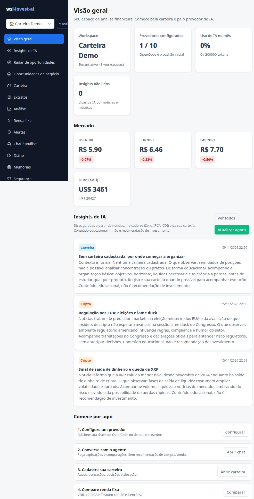 | 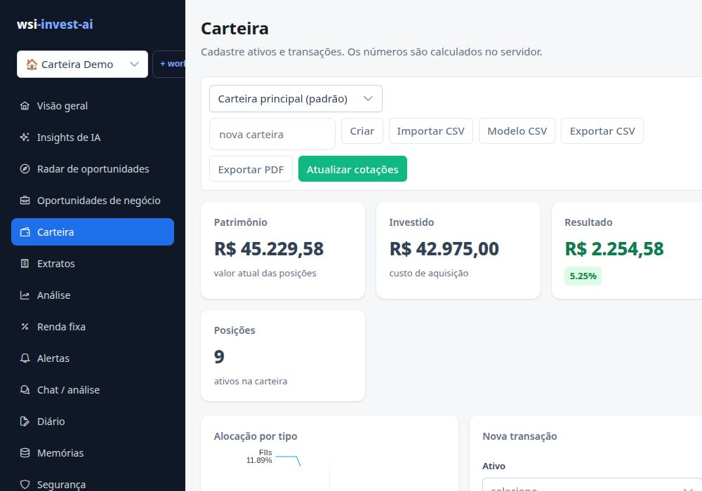 |

| Análise (aporte do dia) | Chat do agente |
|---|---|
| 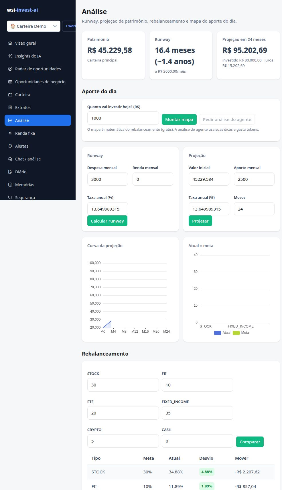 | 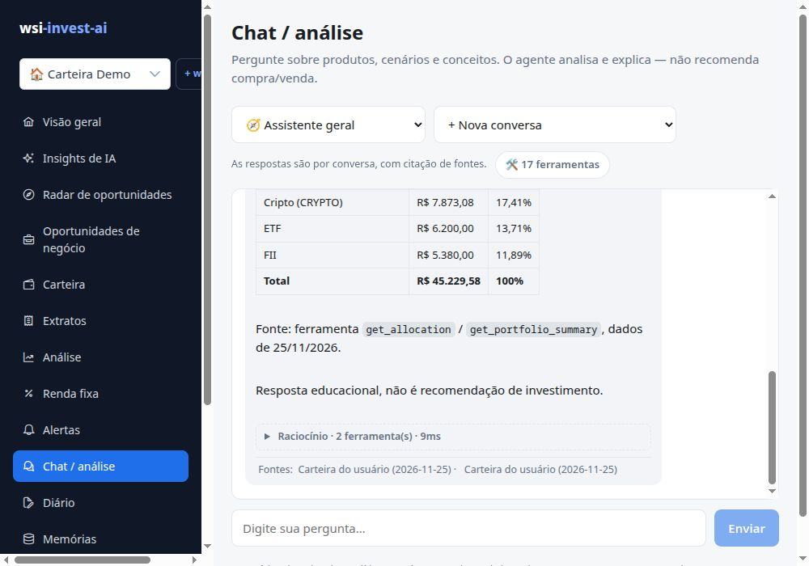 |

| Diário | Radar de oportunidades |
|---|---|
| 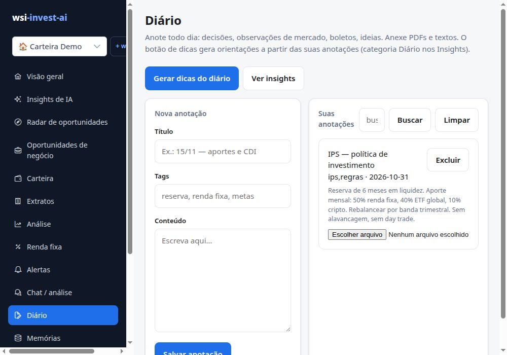 | 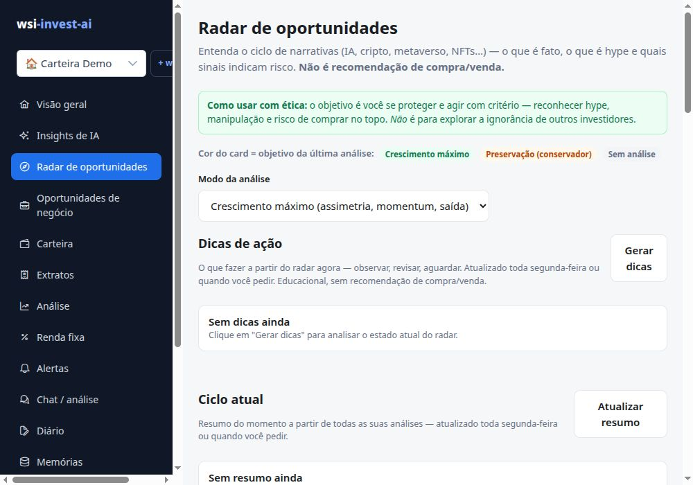 |

| Tracking de ações | Vidente de dicas |
|---|---|
| 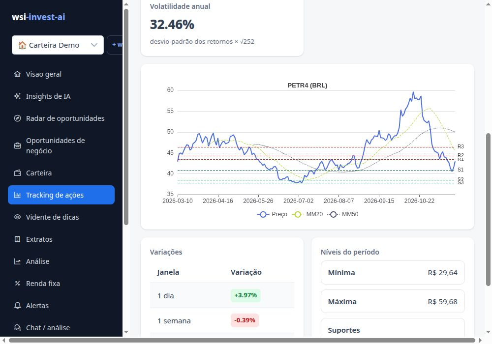 | 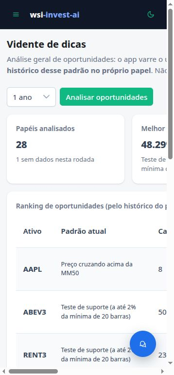 |

| Resumo e perspectiva (tracking) | Descobertas |
|---|---|
| 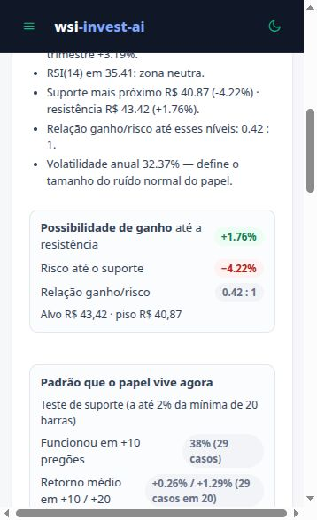 | 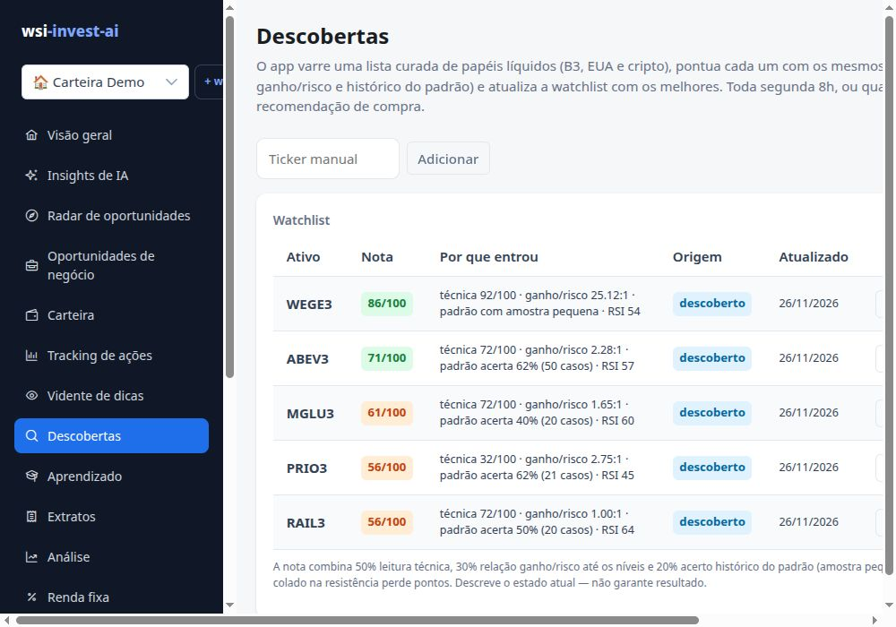 |

| Chat flutuante (global) | Radar — oportunidades em queda |
|---|---|
| 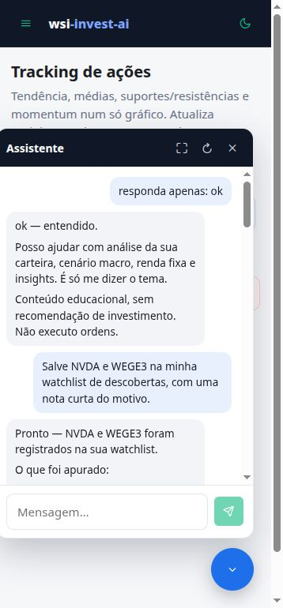 | 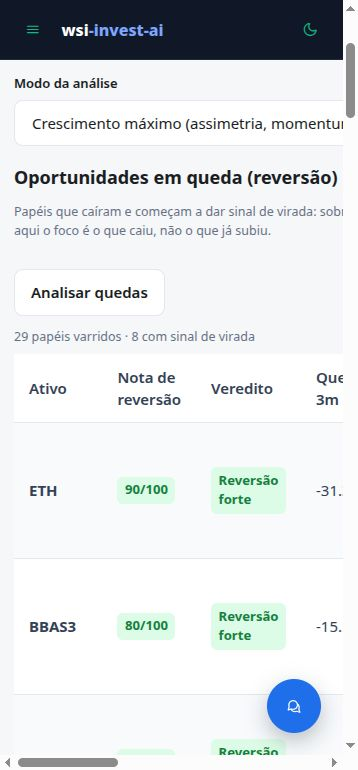 |

| Ciclo do halving (BTC) | Prompts do agente |
|---|---|
| 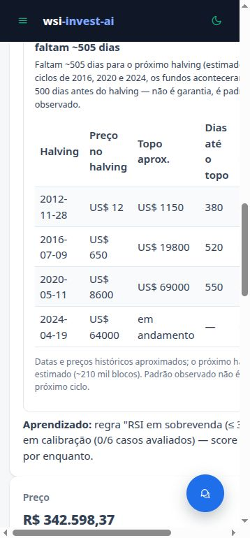 | 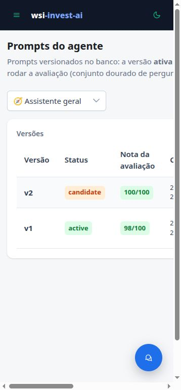 |

| Módulo de ensino (Aprender) |
|---|
| 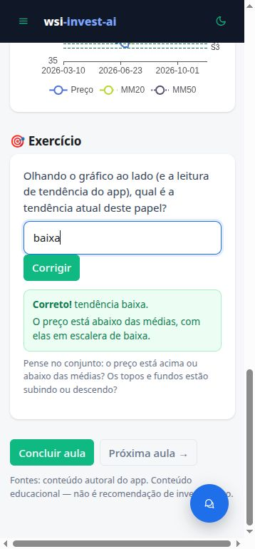 |

## Estrutura

```
wsi-invest-ai/
├── back/          # API NestJS + Prisma (SQLite em prisma/dev.db)
├── front/         # SPA Angular
├── docs/          # documentação
└── scripts/       # up.sh, backup.sh, restore.sh
```

## Documentação

| Documento | Conteúdo |
|---|---|
| [Visão geral](docs/00-visao-geral.md) | problema, escopo, princípios, métricas |
| [Arquitetura](docs/01-arquitetura.md) | camadas, multi-tenant, IA, fluxo |
| [Plano de desenvolvimento](docs/02-plano-desenvolvimento.md) | fases, tarefas, critérios de aceite |
| [Módulos](docs/03-modulos.md) | catálogo back/front + status |
| [Modelo de dados](docs/04-modelo-dados.md) | entidades, relações, regras |
| [IA e provedores](docs/05-ia-provedores.md) | registry, roteamento, tools, guardrails |
| [Segurança e LGPD](docs/06-seguranca-lgpd.md) | ameaças, isolamento, privacidade |
| [ADRs](docs/07-adr.md) | decisões arquiteturais |
| [Roadmap](docs/08-roadmap.md) | MVP, beta, pós-MVP |
| [Ambiente local](docs/09-ambiente-local.md) | como rodar, backup |
| [API](docs/10-api.md) | referência de endpoints |
| [Agente de IA](docs/11-agente-de-ia.md) | arquitetura, tools, memória, streaming |
| [Radar de oportunidades](docs/12-oportunidades.md) | narrativas, ciclo de hype, risco e ética |
| [Oportunidades de negócio](docs/13-negocios.md) | perfil profissional, tipos de negócio e geração de ideias |

## Scripts

| Script | O que faz |
|---|---|
| `scripts/up.sh` | Sobe API + front (SQLite, sem Docker) |
| `scripts/backup.sh` | Backup do SQLite `dev.db` (retém 7 dias) |
| `scripts/restore.sh` | Restaura a partir de um `.db` |

## Variáveis principais (`back/.env`)

```env
DATABASE_URL=file:./dev.db
JWT_ACCESS_SECRET=...        JWT_REFRESH_SECRET=...
GOOGLE_CLIENT_ID=...         GOOGLE_CLIENT_SECRET=...
OPENCODE_API_KEY=...         OPENCODE_MODEL=deepseek-v4-pro
AI_ENCRYPTION_KEY=...        AI_MONTHLY_TOKEN_QUOTA=200000
ADMIN_EMAILS=...             CORS_ORIGINS=...
BRAPI_TOKEN=                 ENABLE_CRON=true
```

## Testes

```bash
cd back && npm test   # 10 testes: renda fixa, isolamento multi-tenant, projeção
```

## Próximo

- Perfis de agente (prompts/tools por papel).
- RAG com embeddings (hoje é busca textual).
- Moedas múltiplas e cotações internacionais.
- Exposição a usuários externos (túnel/TLS, backup agendado, termos/privacidade).
